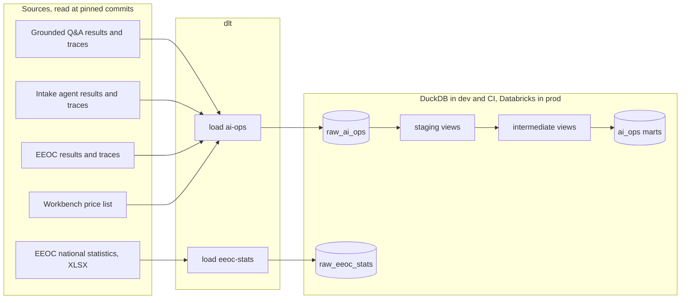

# Data platform

[](https://github.com/iamkevinstreet/data-platform/actions/workflows/ci.yml)
[](https://github.com/iamkevinstreet/data-platform/actions/workflows/codeql.yml)
[](LICENSE)

The warehouse behind three AI projects: dlt loads what each app commits, dbt models it into marts
with enforced contracts, Airflow 3 schedules the loads and the build, and Terraform holds the AWS and
Databricks pieces. The same models build in DuckDB on a laptop and in CI, and in Databricks in
production. For businesses that run AI in production and need to know what it costs, how often it
is right, and where its time goes, from data they can check.

The apps are [Grounded Q&A](https://github.com/iamkevinstreet/grounded-qa), the
[intake conflicts agent](https://github.com/iamkevinstreet/intake-conflicts-agent) and
[EEOC charge intake](https://github.com/iamkevinstreet/eeoc-charge-intake).

## Status

| | |
| --- | --- |
| Works today | The AI operations load and mart, end to end on DuckDB: dlt reads every app's committed run files and traces at pinned commits, and dbt builds 15 views, 15 tables, 4 unit tests and 92 data tests over them. The three DAGs run through Airflow 3.4 itself with `airflow dags test`. The EEOC's national charge receipts load from the EEOC's real XLSX: 338 rows over FY1997 to FY2025, first read in CI on Nov 8, not yet checked against the EEOC's published totals. 34 offline tests, strict types and the code standard |
| Works on Databricks | The same load and build on the Databricks Free Edition's serverless 2X-Small SQL warehouse, from the daily workflow: all 128 models, seeds and tests pass, the reconciliation and the price check among them. On Nov 8 the load took 40 s with the warehouse warm (1 min 44 s from cold) and the build 68 s |
| Measured | On the apps' Nov 7 commits: 194 of 194 figures the apps published rebuilt from case rows, within rounding, and 319 of 319 model calls costed exactly at the workbench's list prices (below), on DuckDB and on Databricks alike |
| Written, not yet run | The S3 copy in the daily workflow, which runs from main only, where the AWS role is trusted; the Databricks Terraform root, which is optional, since dlt and dbt make their own schemas; and the Compose file's Airflow image, which needs Docker. CI validates both Terraform roots against the providers' schemas |
| Next | The EEOC charge warehouse: reviews saved in Postgres by the app, exported as JSON under a versioned contract, loaded and modelled into charges, field reviews and type 2 respondents |

## Quick start

You need [uv](https://docs.astral.sh/uv/). Nothing else: no key, no account, no server.

```bash
make install   # the locked environment
make load      # every app's results at its pin, from GitHub, into data/generated/warehouse.duckdb
make build     # every seed, model, contract and test
make docs      # the dbt docs site with its lineage graph, in dbt/target/static_index.html
make test      # 34 tests, offline, on fixtures
```

To run the DAGs through Airflow, `make install-airflow` then `make dags-test`. To run Airflow's web
UI on this machine, set `POSTGRES_PASSWORD` in `config/.env` and `make up` (Docker).

## How it works



1. **Load.** `python -m pipelines load ai-ops` lists each app's `data/evals/results/` at its pinned
   commit through GitHub's trees API, then reads each run file and trace from
   raw.githubusercontent.com. The pins in [`config/config.toml`](config/config.toml) are full commit
   SHAs, and a branch or short SHA is refused, so the same pins always give the same rows. Every table
   merges on its key, so a second load of the same pins changes nothing; a test proves it.
2. **Keep only numbers.** The apps' traces were recorded with prompt and answer text on, since their
   data is generated. The loader keeps each span's ids, times, status and GenAI attributes (model,
   tokens, cost, finish reason, tool name) and nothing a document or a person said: no prompt, answer,
   retrieval query, tool argument or value read. A test checks no raw column could hold text.
3. **Contract the raw tables.** Each raw table is a Pydantic model in
   [`pipelines/rows.py`](pipelines/rows.py), which dlt also reads for the table's columns. A field the
   contract does not know fails the load instead of adding a column.
4. **Model.** dbt staging views rename and cast; intermediate views line the two run formats up to one
   grain; the `ai_ops` marts are tables with enforced contracts. A trace's case id lives only on its
   root span, so a window function gives it to every span under it.
5. **Reconcile.** `fct_run_metrics` rebuilds every figure an app published in a run's summary
   (means, sums, ratios and nearest-rank percentiles) from the case rows, beside the published value.
   The build fails if any pair differs by more than the figure's rounding.
6. **Schedule.** Two DAGs load, each updating an Airflow asset; the build DAG is scheduled on either
   asset, not on a clock. Every task runs the same `python -m pipelines` command a person would.

## Results

From a load of the apps' Nov 7 commits, Nov 8, 2026, on DuckDB.

| | |
| --- | --- |
| Loaded | 16 run files (10 live, 2 offline, 4 retrieval), 600 cases and 60 scenarios, 7,800 scores, 893 spans, the 167 model calls and 224 tool calls the intake agent recorded, 11 model prices |
| Reconciled | 194 of 194 published summary figures, across 12 runs, rebuilt from case rows within rounding |
| Costed | 319 of 319 model calls: each recorded cost equals its tokens at the list price valid on its run's date |
| Spent | $7.02 on the 10 live runs |

Where extraction went wrong: EEOC's one run below 100% (Oct 17) missed in one field only. `issues`
was wrong on 28 of its 40 documents, and every other field was right on all 40, which is what the
EEOC project's own README says of that run. Every later run was right on every field.

Where a traced case's time goes, from the Nov 7 traces: the model call is 98.6% (intake agent) to
99.8% (EEOC, Grounded keyword) of it. Hybrid retrieval is 0.6% of a Grounded answer, the intake
agent's tool calls 1.1%, and every quote check under 0.1%. So the model is the lever for speed, and
the retrieval mode is a question of quality, not time.

| App, live run | Date | Cases | Judged right | Cost per case | Median | 95th percentile |
| --- | --- | ---: | ---: | ---: | ---: | ---: |
| EEOC, extraction | Oct 17 | 40 | 93.0% of fields | $0.0119 | 4.3 s | 4.8 s |
| EEOC, extraction | Oct 17 | 40 | 100% | $0.0134 | 4.2 s | 6.5 s |
| EEOC, extraction | Oct 26 | 200 | 100% | $0.0134 | 4.5 s | 5.6 s |
| EEOC, extraction | Nov 7 | 40 | 100% | $0.0133 | 4.4 s | 6.2 s |
| Grounded, keyword | Oct 29 | 56 | 86.7% of answers | $0.0079 | 2.7 s | 6.0 s |
| Grounded, hybrid | Oct 29 | 56 | 88.9% | $0.0084 | 2.7 s | 8.3 s |
| Grounded, keyword | Nov 7 | 56 | 88.9% | $0.0082 | 2.8 s | 5.8 s |
| Grounded, hybrid | Nov 7 | 56 | 88.9% | $0.0081 | 2.4 s | 6.3 s |
| Intake agent | Oct 29 | 20 | 100% of verdicts | $0.0246 | 7.9 s | 10.7 s |
| Intake agent | Nov 7 | 20 | 100% | $0.0245 | 6.7 s | 9.3 s |

Every model here is `claude-sonnet-5-5`. "Judged right" is each app's own measure, averaged over
its cases: `field_accuracy` (EEOC), `correct` (Grounded), and the verdict shown to the approver
matching the expected one (intake). The Nov 7 runs are on the apps' publish branches; the pins move to main when they merge.

## The marts

| Model | One row per |
| --- | --- |
| `dim_apps`, `dim_models` | App, with the metric its runs are judged by; model, with its current list prices |
| `dim_model_prices` | Model per version of the price list, type 2: valid from its date until the next |
| `fct_eval_runs` | Evaluation run: cases, failures, cost, percentiles, tokens, the judged metric |
| `fct_eval_cases`, `fct_case_metrics` | Case of a run, with its tags and tokens; metric of a case |
| `fct_run_metrics` | Published summary figure, rebuilt beside the published value |
| `fct_model_calls`, `fct_tool_calls` | Model call, from the trace or the agent's record, list-priced; tool call |
| `fct_spans` | Span of a committed trace, with its case |
| `fct_retrieval_scores` | Measure of a question under one search mode in a retrieval run |
| `rpt_cost_by_month` | Month, app and model, over live runs |
| `rpt_run_changes` | Live run beside the last run of its name: how the judged metric, cost and time moved |
| `rpt_latency_by_operation` | Traced run and operation; an operation's time includes the spans under it |
| `rpt_field_accuracy` | Run and field, for an app that scores each field: how often the model read it right |

## Design

- **DuckDB in dev and CI, Databricks in production.** Every pull request builds and tests every
  model on real data in a minute, for nothing. The SQL keeps to what both run (window functions,
  `percentile_disc`, dbt's cross-database macros), and contract types are names both accept.
  Databricks is the production target because the apps are AI products and one platform covers
  Spark, streaming, Delta tables readable as Iceberg, Unity Catalog and vector search.
- **dlt for loading.** Each source is a short Python file a reviewer can read, with schema inference
  held in check by the Pydantic contract, merge loads on natural keys, and the same code for DuckDB
  and Databricks.
- **Airflow only schedules.** Every task runs `uv run --no-sync python -m pipelines ...` in the
  locked environment, so a DAG holds no logic of its own, and moving to a hosted Airflow (Astro,
  MWAA) changes the deployment, not the code. The daily workflow runs the DAGs with
  `airflow dags test`, so there is no Airflow server to pay for.
- **Pins, not branches.** Results are read at full commit SHAs, so a load is repeatable and its
  rows can be traced to a commit and a git blob.
- **Keys, not passwords.** GitHub Actions reaches AWS through an IAM role that trusts one
  repository's main branch, through GitHub's OIDC token, for an hour at most, and can list, read and
  add objects in one bucket, never delete them.
- **No MinIO.** MinIO stopped publishing its community images in late 2025, so files to load stay in
  a folder locally; the loaders read S3 in CI and production.

## Configuration

Every setting is in [`config/config.toml`](config/config.toml), at its default, and a test keeps it
equal to the defaults in [`pipelines/config.py`](pipelines/config.py). Secrets go in `config/.env`;
[`config/.env.example`](config/.env.example) names each. A load to DuckDB needs none. See
[`config/README.md`](config/README.md).

## Testing

`make test` runs 34 tests with no network:

- the parsing of each format, on the apps' real Nov 7 results cut to a few cases (`tests/fixtures/`),
  each summary recomputed by the app's own summary code so the cut set still reconciles;
- the load end to end into a DuckDB file of the test's own, a second load changing nothing, no text
  column, and `dbt build` passing on what was loaded;
- the EEOC table's reader on a workbook built in the EEOC's layout;
- the GitHub reader, the settings, the DAGs as Airflow parses them, the Terraform and the Compose
  file.

`make check` runs ruff, strict mypy and the code standard. CI also loads the real results, builds on
them, validates the Terraform and the Compose file, and scans the whole history for secrets.

## Project layout

| Path | What it holds |
| --- | --- |
| `pipelines/` | The dlt sources, the raw contract, and `python -m pipelines`, which the DAGs run |
| `dbt/` | The dbt project: staging, intermediate and `ai_ops` models, seeds, macros and tests |
| `dags/` | The Airflow 3 DAGs ([`dags/README.md`](dags/README.md)) |
| `infra/` | Terraform for AWS and Databricks ([`infra/README.md`](infra/README.md)) |
| `config/` | Every setting and the secrets template ([`config/README.md`](config/README.md)) |
| `tests/` | The tests and their fixtures |
| `data/` | Only `generated/`, ignored: the warehouse, dlt's state, Airflow's home ([`data/README.md`](data/README.md)) |
| `compose.yaml`, `Dockerfile` | Airflow and its Postgres on this machine |

## Changelog and license

[CHANGELOG.md](CHANGELOG.md). Apache 2.0: see [LICENSE](LICENSE) and [NOTICE](NOTICE). Security
reports: [SECURITY.md](SECURITY.md).
